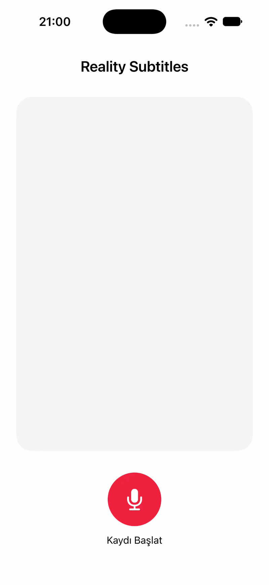

# Reality Subtitles

An early-stage project exploring real-time Turkish subtitles, with a SwiftUI iOS app and research into audio-visual speech recognition.

The current iOS app records audio and transcribes it into Turkish after recording stops, using WhisperKit with the multilingual tiny model and an explicit Turkish language setting (`tr`). Live transcription and visual speech recognition are planned work.

## App demo

<p align="center">
  
</p>

## Current status

| Component | Available today |
| --- | --- |
| iOS app | Microphone access, start/stop recording, temporary audio capture, and Turkish transcription after recording stops |
| Web prototype | Turkish speech-to-text using the browser Web Speech API |
| Research | Initial notes on speech recognition, datasets, and audio-visual approaches |

## Run the iOS app

1. Clone this repository and open `ios/RealitySubtitles.xcodeproj` in Xcode.
2. Select the **RealitySubtitles** scheme and an iPhone simulator or connected iPhone.
3. For a physical device, select your signing team in **Signing & Capabilities**.
4. Run the app, allow microphone access, and use **Kaydı Başlat** / **Kaydı Durdur** to record audio. After stopping, wait for the Turkish transcript to appear. The first transcription requires an internet connection to download the model.

The project currently targets **iOS 27.0** and was verified with **Xcode 27.0**. Audio is captured in the app's temporary directory and deleted after transcription, including on failure. Interrupted recordings are cleaned up on the next launch. Older audio in `Documents/recording.m4a` and `Documents/BenchmarkRecordings` is removed on startup.

Build verification: the app, unit-test target, and UI-test target compiled successfully for iOS Simulator with signing disabled. This verifies compilation; it does not represent an automated microphone or recording test.

## Benchmark Whisper Tiny

Processing time appears below the transcript and in the Xcode console with three decimal places. A monotonic `ContinuousClock` surrounds only the existing WhisperKit transcription call, excluding recording, model download/loading, audio-duration lookup, and CSV writing. It includes the work WhisperKit performs inside its file-transcription call.

1. Record a short sample using **Kaydı Başlat**, then **Kaydı Durdur**, and wait for transcription to finish.
2. Every successful transcription saves its model, temporary audio filename, audio duration, processing time, and Turkish transcript to `Documents/benchmark-results.csv`. Only the latest 10 results are retained; older rows are removed on startup and after each new result.
3. Tap **CSV sonuçlarını paylaş** to export the results through the iOS share sheet.

Audio files are never retained for replay. The temporary file is deleted after processing even if transcription or CSV writing fails. The filename in CSV is only an identifier. Earlier saved benchmark recordings and their numbering counter are removed automatically on startup, while CSV results are preserved within the 10-result limit.

The app uses `openai_whisper-tiny` with Turkish decoding. For meaningful device comparisons, use the same iPhone and build configuration; these measurements do not automatically warm up or optimize the model.

## Explore the repository

```text
reality-subtitles/
├── README.md
├── ios/
│   ├── RealitySubtitles/
│   ├── RealitySubtitles.xcodeproj/
│   ├── RealitySubtitlesTests/
│   └── RealitySubtitlesUITests/
├── demo/
│   └── index.html
└── docs/
    ├── project/
    └── progress/
        ├── week-01/
        ├── week-02/
        └── week-03/
```

- **[iOS app](ios/)** — current native application and its Xcode project.
- **[Web prototype](demo/index.html)** — the initial Turkish subtitle experiment. Open it in a browser supporting the Web Speech API and allow microphone access; support varies by browser.
- **[Week 1 research](docs/progress/week-01/Reality%20Subtitles%201.%20week.pdf)** — the original project notes, preserved for reference.
- **[Week 2 report](docs/progress/week-02/week-02-report.pdf)** — the second weekly progress report.
- **Week 3 documents** — [Document 2](docs/progress/week-03/week%203%20%282%29.pdf) and [Document 3](docs/progress/week-03/week%203%20%283%29.pdf).

## Project documents

These Turkish-language documents describe the initial proposal and planned scope. They are planning references, not a record of implemented features or completed experiments. The current implementation status is listed above.

| Document | Purpose |
| --- | --- |
| [Project proposal (PDF)](docs/project/project-proposal.pdf) | Research question, proposed method, scope, and expected outputs |
| [Six-month plan (Word)](docs/project/six-month-plan.docx) | 24-week plan, milestones, evaluation approach, and risks |
| [Long-term vision (Word)](docs/project/long-term-vision.docx) | Future product directions beyond the initial iOS scope |

## Roadmap

- [x] Create the initial browser speech-to-text prototype.
- [x] Build the SwiftUI iOS app with audio recording.
- [x] Add Turkish transcription after recording stops using WhisperKit's multilingual tiny model, with language fixed to `tr`.
- [x] Display transcription progress, readable results, and transcription error messages in the iOS app.
- [ ] Validate end-to-end transcription on a physical iPhone, including first-time model download, repeated recordings, silence, and error recovery.
- [ ] Measure Turkish transcription accuracy and processing time; compare speech recognition approaches and model sizes.
- [ ] Add live Turkish subtitles while recording; the current implementation transcribes only after recording stops.
- [ ] Investigate visual speech recognition and suitable datasets.
- [ ] Explore an audio-visual subtitle architecture based on the speech and visual recognition findings.
